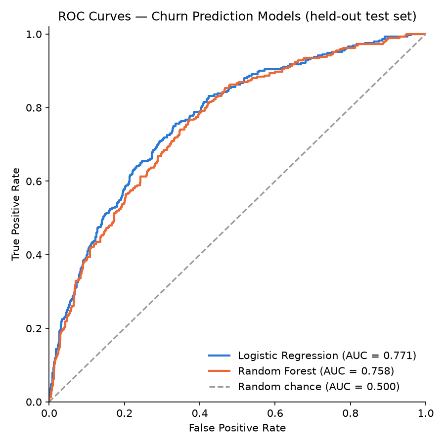

# Churn Model Evaluation Report

Metrics below are computed on a held-out test set (20% of the data, stratified split, never used for training or cross-validation).

## Metrics

| Model | Accuracy | Precision | Recall | F1 | ROC-AUC |
|---|---|---|---|---|---|
| Logistic Regression | 0.754 | 0.628 | 0.387 | 0.479 | 0.771 |
| Random Forest | 0.751 | 0.642 | 0.332 | 0.438 | 0.758 |

## Confusion Matrices

**Logistic Regression**  (rows = actual [no-churn, churn], columns = predicted [no-churn, churn])

```
[[  641    67]
 [  179   113]]
```

**Random Forest**  (rows = actual [no-churn, churn], columns = predicted [no-churn, churn])

```
[[  654    54]
 [  195    97]]
```

## ROC Curve



## Analysis

**Winner: Logistic Regression**

Logistic Regression achieves the higher ROC-AUC (0.771 vs. 0.758 for Random Forest). This is plausible because the synthetic label is generated directly from a linear combination of the (encoded) features passed through a sigmoid — i.e. the true data-generating process is close to logistic — so a correctly-specified logistic model can match that structure almost exactly, while the Random Forest has more variance and can slightly overfit non-existent interactions on a dataset of this size.

## Random Forest — Top 5 Feature Importances

| Feature | Importance |
|---|---|
| num__support_tickets_last_90d | 0.2063 |
| num__tenure_months | 0.1436 |
| cat__contract_type_month-to-month | 0.1387 |
| num__total_charges | 0.1241 |
| num__avg_weekly_usage | 0.1150 |
